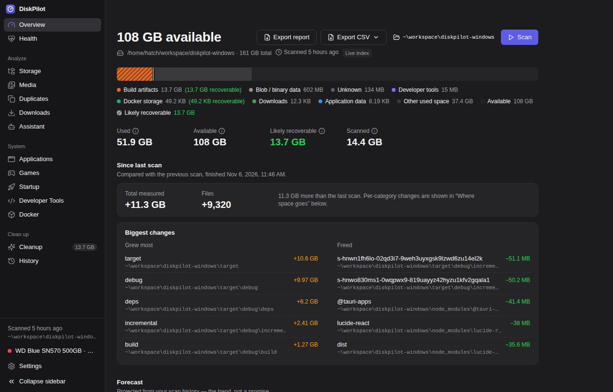
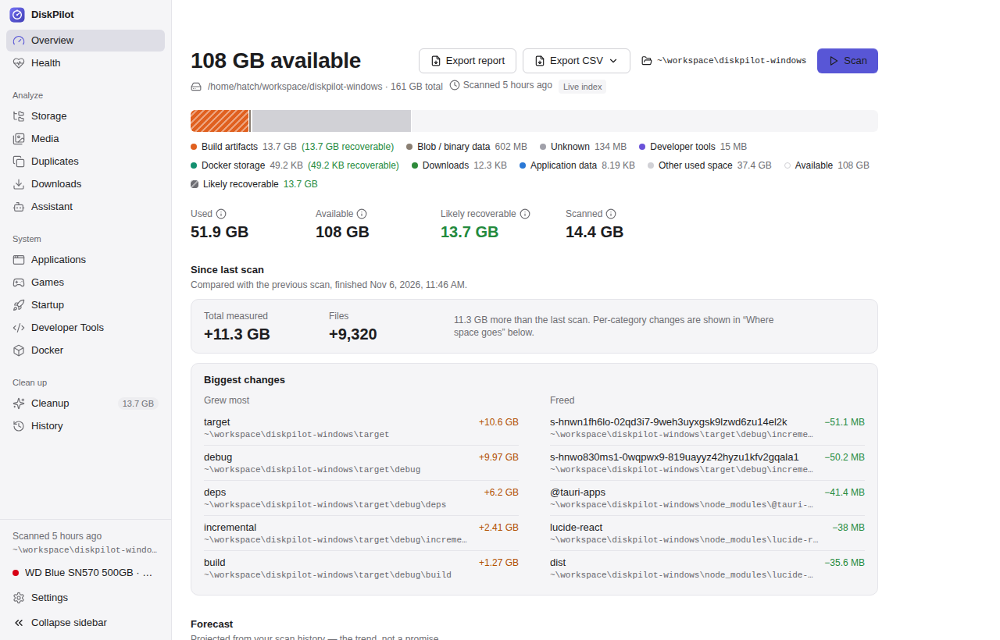
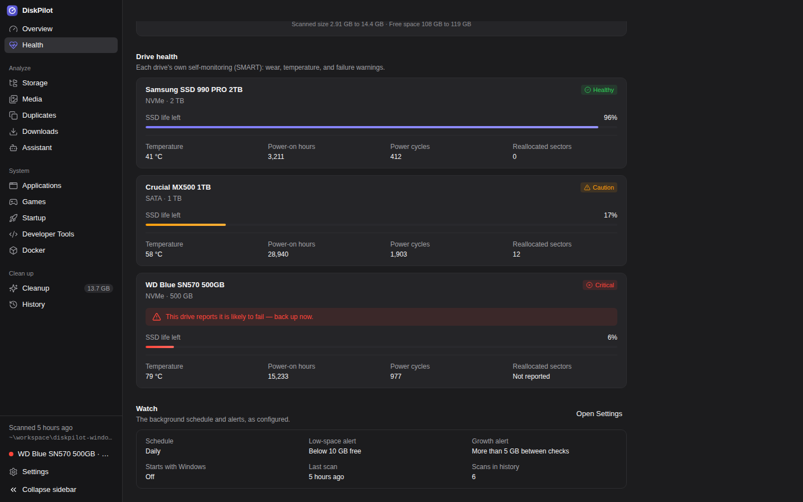
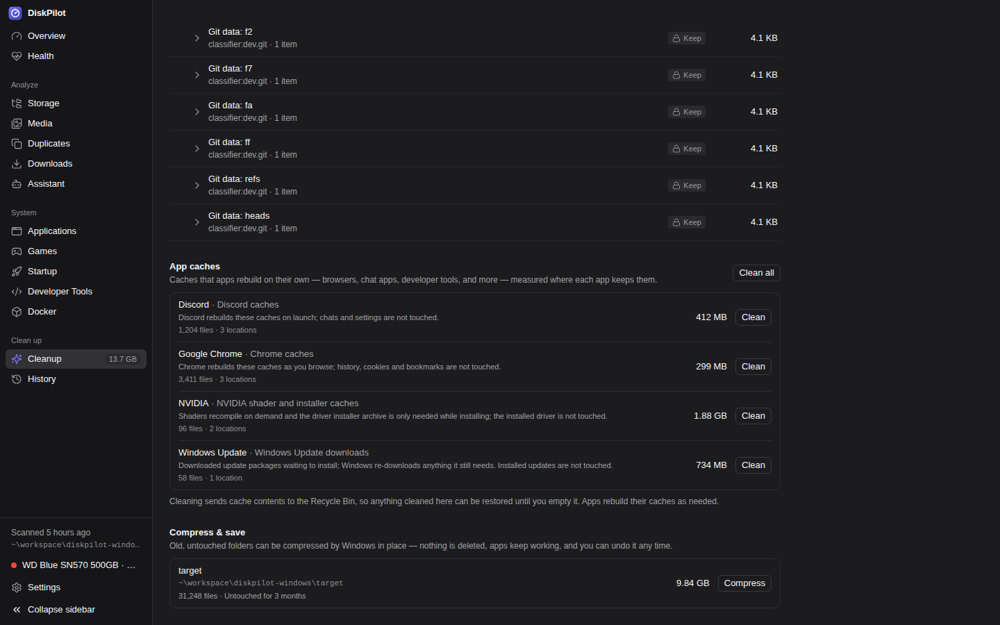
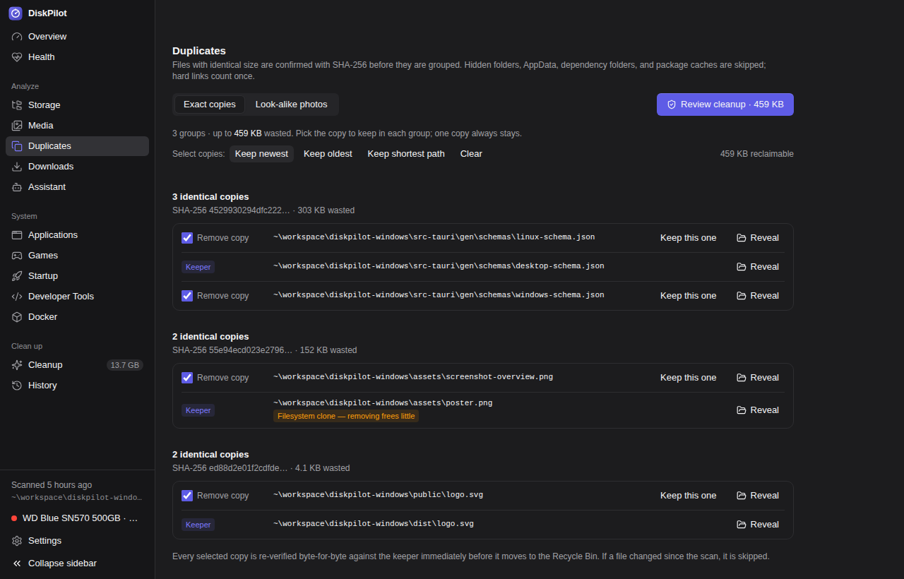
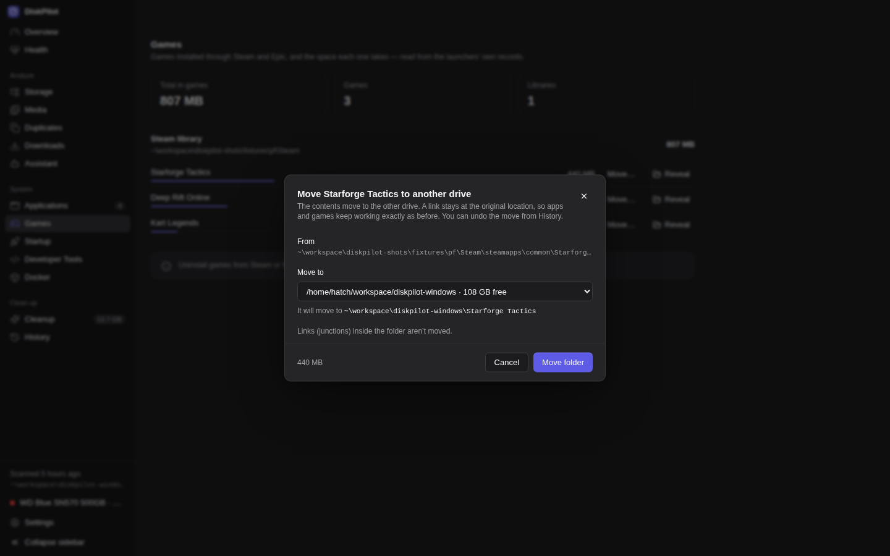
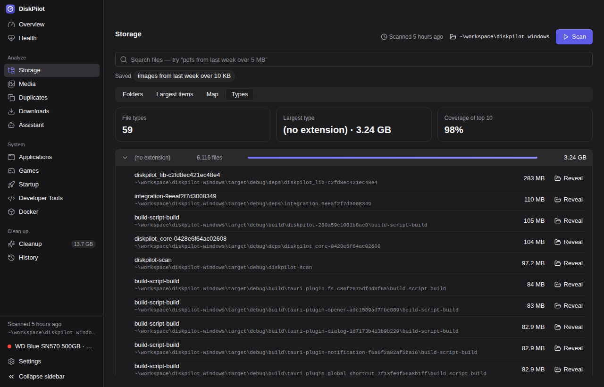
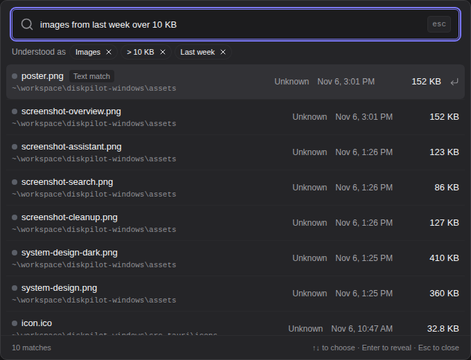
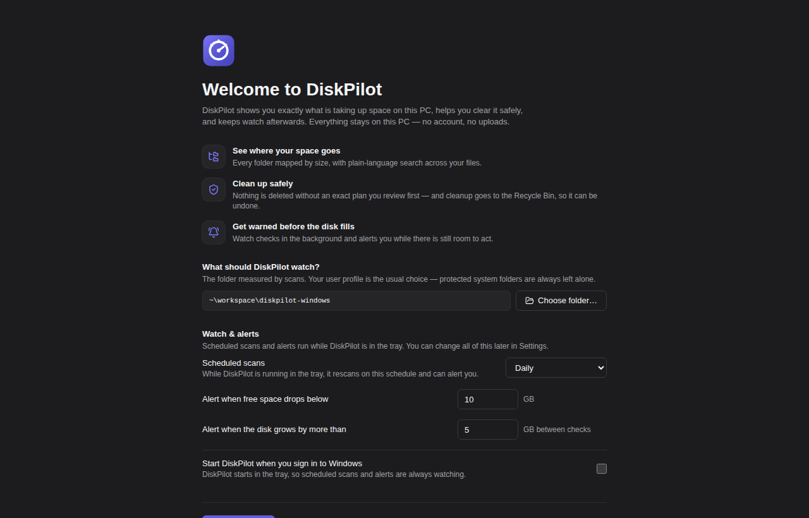
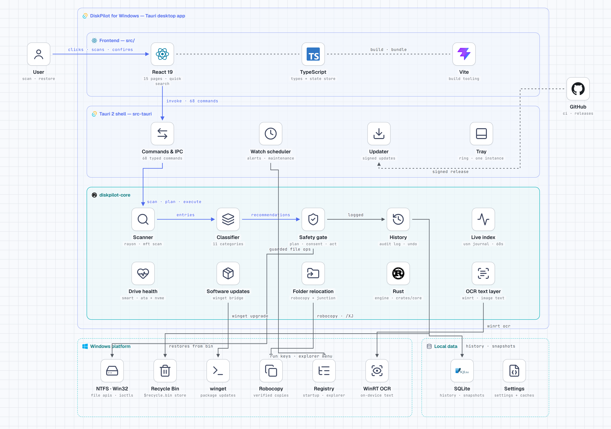

# DiskPilot for Windows

**The storage manager for Windows that shows you everything, deletes
nothing without your approval, and can undo what it does.**

[](LICENSE)
[](https://www.microsoft.com/windows)
[](https://tauri.app)
[](https://www.rust-lang.org)
[](https://react.dev)

DiskPilot is open-source storage intelligence for Windows. It scans
your drives read-only, explains — in plain language — what is using
space and why it is there, and only ever removes files through a
reviewed cleanup plan that passes a strict safety gate. Nothing is
deleted silently, the default for everything is the Recycle Bin, and
every action it takes is written to a local history you can audit —
and, for cleanups, undo.

[](assets/DiskPilot-Walkthrough.mp4)

**▶ Watch the full walkthrough** — a tour of the scan, the safety
pipeline, and a complete cleanup, end to end.



## Install

Grab the latest installer from
[Releases](https://github.com/anilkumara9/diskpilot/releases):

- **NSIS installer (`.exe`) — recommended.** Installs per-user into
  your profile: no administrator rights needed to install or run.
  (Two features — the fast NTFS scan and the live index — read the
  drive's raw structures and engage only when *you* choose to run
  DiskPilot as administrator; everything else works the same either
  way.)
- **MSI (`.msi`) — alternative.** A per-machine install for managed
  or multi-user machines; needs administrator rights.

**Windows SmartScreen:** DiskPilot is not yet signed with a
code-signing certificate, so SmartScreen may warn the first time you
run the installer. Choose *More info → Run anyway*. Every release
ships a `SHA256SUMS.txt` so you can verify the installer you
downloaded is the one that was published.

**Updates:** once installed, DiskPilot checks for updates on launch
and can download and install them itself (Settings → *About &
updates*, or the *Update available* flag on the Settings entry).
Update packages are cryptographically signed and verified in the app
before anything installs — an update that fails verification is
refused, never applied.

> **Early release.** 0.6.0 is DiskPilot's first public release. The
> engine is heavily tested — the safety pipeline, parsers and
> policies are covered by an extensive test suite exercised on every
> commit — and verification of the Windows-machine paths (installer,
> device reads, folder moves) is ongoing. See
> [docs/RELEASING.md](docs/RELEASING.md) for how releases are built
> and checked.

## One app for the whole disk

Most PCs end up with a folder full of single-purpose tools — one to
see the disk, one to clean it, one to watch the drive, one to update
apps. DiskPilot is the whole loop in one place:

### Find

- **Fast scans** — a parallel walker for everyday scans, and a direct
  Master File Table reader for whole NTFS drives when DiskPilot runs
  as administrator: a full-drive scan in a fraction of the time, with
  identical results either way.
- **Live index** — between scans, the volume's USN change journal
  keeps search and size views current within about a minute.
- **Quick Search** — press **Ctrl+Shift+Space** anywhere in Windows
  for the search popup over whatever you are doing.
- **Search that reads pictures** — Windows' built-in OCR (on-device,
  nothing sent anywhere) reads the text inside screenshots and
  images, so a file is findable by the words in it; hits found that
  way are marked *Text match*.
- **Plain-language search** — type `pdfs from last week over 5 MB`
  and DiskPilot shows how it understood you as removable chips
  before it runs; searches you reuse can be **saved**.

### Understand

- **Treemap + drill-down explorer** — every folder and large file a
  block sized by its bytes, colored by category, with a details
  inspector for any item: facts, classification, download source.
- **Storage by type** — the whole scan ranked by file extension,
  each type expandable to its largest files.
- **Media, games, applications views** — photos / videos /
  screenshots totals, Steam and Epic libraries read from the
  launchers' own manifests, installed apps with their AppData
  footprints (including leftovers from uninstalled apps).
- **Forecast + biggest changes** — a growth trend over your scan
  history projects the date the drive fills, and every new scan is
  diffed against the last: what grew, what shrank, what you got back.
- **Reports** — a standalone HTML storage report, plus CSV exports
  of the largest files and the category totals.

### Clean

- **Safety-planned cleanup** — recommendations in three risk tiers
  (*Likely safe* / *Review first* / *Keep*), each explaining why it
  was detected and what could go wrong. You review the exact plan —
  paths, bytes, warnings — before anything moves.
- **App caches** — a curated rule set measures the regenerable
  caches generic temp rules can't see: Discord, Slack, Teams,
  Chrome, Edge, Firefox, VS Code, NVIDIA shader and driver caches,
  the DirectX shader cache, Windows Update downloads, Explorer's
  thumbnail caches. Never profiles, history, cookies or offline
  data.
- **Compress & save** — big folders untouched for 90+ days can be
  NTFS-compressed in place with `compact.exe`: nothing is deleted,
  the folder keeps working, and it is reversible.
- **Duplicates** — exact copies confirmed with SHA-256 and
  re-verified byte-for-byte before any copy moves; a **smart-select**
  bar picks the keeper in every group at once; a second tab finds
  **look-alike photos** (review-only — one copy always stays).
- **Docker + developer tools** — read-only analyzers for Docker
  storage and the caches of editors, AI agents, Node, Rust, Python
  and more, with each tool's own hygiene command shown where one
  exists instead of deleting behind its back.

### Protect

- **Drive health (SMART)** — every physical drive's self-monitoring
  data (ATA attributes or the NVMe health log): SSD life left,
  temperature, power-on hours, reallocated sectors, and a *Healthy /
  Caution / Critical* verdict. A drive that predicts its own failure
  says so in plain words — back up now. Values a drive doesn't
  report are shown as *Not reported*, never guessed.
- **Software updates** — the Applications page checks `winget` for
  newer versions of your installed apps and runs the upgrade for one
  app or all of them, each result reported as it actually came back.
- **Protected by construction** — `C:\Windows` (including WinSxS),
  Program Files, ProgramData, Recovery, drive roots and the paging /
  hibernation files are never touched; `Windows.old` is report-only,
  with the removal route through Windows' own storage tools.

### Maintain

- **Automatic safe maintenance** — on a schedule, DiskPilot
  permanently clears only what is already safe to lose: Recycle Bin
  items and temporary files older than the age you set, through the
  same safety gate as a manual cleanup. Every run is recorded in
  History.
- **Watch** — scheduled daily or weekly scans while the app sits in
  the tray, with notifications when free space drops below your
  threshold or usage grows past your limit. Manual scans never
  raise alerts.
- **Startup manager** — everything that opens when you sign in,
  listed with its target and size; entries are disabled and
  re-enabled reversibly — nothing is deleted.
- **Recycle Bin, properly** — contents listed before anything
  happens, per-item restore to the original location (refused when
  something already sits there), and item-by-item emptying with
  progress and a Stop button.

### Reclaim

- **Move to another drive** — a big folder or game, moved from
  Storage or Games: DiskPilot copies it, verifies the copy
  file-for-file (count and allocated bytes), and only then replaces
  the original with a directory junction, so every app keeps finding
  it at the old path. Any failure leaves the original untouched, and
  every move can be **undone from History** the same verified way.
- **OneDrive free-up** — files and folders can be marked online-only
  from the Overview or the inspector, asking OneDrive to evict the
  local copies. Nothing is deleted; the space frees as OneDrive
  syncs.

There is also an optional **assistant** (off by default): a chat over
your scan data with your own Anthropic, OpenAI or OpenRouter key —
stored in Windows Credential Manager, never readable back. Its tool
set is fixed and read-only; it cannot delete, move or run anything.

## Safety model

Safety is not a settings page in DiskPilot; it is the architecture.

- **Scanning is read-only.** The scanner never follows symlinks,
  junctions or reparse points, never crosses volumes, and never
  opens OneDrive placeholders (which would trigger a download).
- **Every cleanup is a reviewable plan.** The UI sends recommendation
  IDs, never paths — the planner resolves them against the engine's
  own data, so a buggy or compromised UI cannot inject a path. A
  plan lists exact paths and bytes, is single-use, and expires after
  10 minutes.
- **Trash first.** The default action is the Recycle Bin.
  *Permanently delete* is offered only when every item in the plan
  is regenerable, and the engine re-validates every path immediately
  before execution — a path swapped for a link after planning is
  caught.
- **Cleanups can be undone.** History records where every item went;
  while items are still in the Recycle Bin, one Restore action puts
  a whole run back and reports exactly what came back.
- **Moves are copy → verify → link.** A folder move verifies the
  copy before the original is replaced, and a failed verification
  rolls back — also verified — instead of leaving you with less
  than you started.
- **Results tell the whole truth.** A partial cleanup is never
  reported as a success: what succeeded, what failed and why is what
  the UI shows and what History records.
- **Everything is local.** No account, no telemetry, no analytics,
  no crash reporting. The optional assistant is the only network
  feature, and it talks directly to your chosen provider.
- **One measuring rule.** Every size in the product is *allocated*
  bytes — the space a file actually occupies and a cleanup actually
  frees — so the same file shows the same size on every page.

## Screenshots

| | |
|---|---|
|  |  |
| **Overview** — the disk at a glance, light theme | **Health** — every drive's SMART verdict, wear and temperature |
|  |  |
| **Clean Up** — app caches measured per app, cleaned to the Recycle Bin | **Duplicates** — smart-select picks the keeper in every group at once |
|  |  |
| **Move to another drive** — copy, verify, link; undo from History | **Storage by type** — the scan ranked by extension |
|  |  |
| **Quick Search** — Ctrl+Shift+Space, over whatever you are doing | **First run** — a short guided setup, applied only when you start |

## Architecture



[System design as SVG](docs/assets/system-design.svg) ·
[Full architecture notes](docs/ARCHITECTURE.md)

Three layers, one direction. The **React frontend** renders and asks —
it has no filesystem or shell access at all; its only channel to the
machine is the shell's typed command set. The **Tauri shell** bridges:
window, tray, settings, single-instance launches, the signed updater,
and one typed command per frontend call. The **Rust core**
(`diskpilot-core`) decides — it is the only code that can remove
files, and it does so only through the safety pipeline: scanner
(read) → classifier (pure) → recommendations (explain only) →
planner (preview) → safety gate (validate) → executor (act) →
History (record).

See [docs/ARCHITECTURE.md](docs/ARCHITECTURE.md) for the full data
flow, [docs/DESIGN.md](docs/DESIGN.md) for the design system, and
[docs/WINDOWS.md](docs/WINDOWS.md) for platform measurement details.

## By the numbers


| | |
|---|---|
| Automated tests | **430 passing** — 233 in the Rust core (203 unit + 30 integration), 197 in the frontend (vitest) |
| Pages | **15** in the main window, plus the Quick Search window |
| Typed shell commands | **68** — the only channel between the UI and the machine |
| App-junk rules | **11** curated per-app cache rule sets |
| Classifier categories | **11** — every scanned path lands in exactly one, with the rule that matched |
| Source size | **47,452 lines** — 29,061 Rust · 18,129 TypeScript/React · 262 CSS |

Counts measured on the 0.6.0 tree (tests run locally; the same
suites run in CI on every commit).

## Build from source

Prerequisites:

- [Rust](https://rustup.rs) 1.82 or newer
- [Node.js](https://nodejs.org) 20 or newer (npm)
- Visual Studio Build Tools with the *Desktop development with C++*
  workload (Tauri's Windows toolchain)
- WebView2 runtime (preinstalled on Windows 11 and current Windows
  10; the installer fetches the bootstrapper if it is missing)

```powershell
npm ci
npm run app:dev     # run the desktop app with hot reload
npm run app:build   # MSI + NSIS installers in src-tauri/target/release/bundle
```

Frontend-only development, checks, and tests:

```powershell
npm run dev         # frontend in a browser (shows the desktop-only state)
npm run build       # tsc + vite
npm run lint        # eslint
npm run test        # vitest
cargo fmt --all -- --check
cargo clippy --workspace --all-targets -- -D warnings
cargo test --workspace
```

CI runs the full check suite on `windows-latest` and builds the MSI
and NSIS installers there; the core crate's tests also run on
`ubuntu-latest`, so the engine's logic is checked even where Windows
APIs sit behind `cfg`.

## Project layout

```text
crates/core/     Rust engine (diskpilot-core) — the safety pipeline lives here
src-tauri/       Tauri 2 shell: typed commands, tray, settings, bundle config
src/             React 19 + TypeScript frontend
  lib/           types, api bridge, store, formatting
  components/    layout, shared widgets, UI primitives
  features/      one folder per page
docs/            ARCHITECTURE.md · DESIGN.md · WINDOWS.md · RELEASING.md
docs/assets/     hero image, screenshot gallery, system-design diagram
assets/          walkthrough video + poster
```

Documentation: [Architecture](docs/ARCHITECTURE.md) ·
[Design system](docs/DESIGN.md) · [Windows notes](docs/WINDOWS.md) ·
[Releasing](docs/RELEASING.md) · [Changelog](CHANGELOG.md) ·
[Security](SECURITY.md)

## Contributing

Contributions are welcome — see [CONTRIBUTING.md](CONTRIBUTING.md).
The bar is the safety model: new analyzers and rules must be
read-only by construction, explain themselves, and ship with tests on
real temporary folder trees.

## Security

Found a vulnerability? Please report it privately through the
repository's security advisory feature rather than a public issue —
see [SECURITY.md](SECURITY.md) for what to include. A way around the
safety gate counts as a critical vulnerability here.

## Star history

[](https://github.com/anilkumara9/diskpilot/stargazers)
[](https://github.com/anilkumara9/diskpilot/forks)

[](https://github.com/anilkumara9/diskpilot/stargazers)

DiskPilot went public with 0.6.0. If it earns a place on your
machine, a star helps other people find it.

## License

MIT — see [LICENSE](LICENSE).
