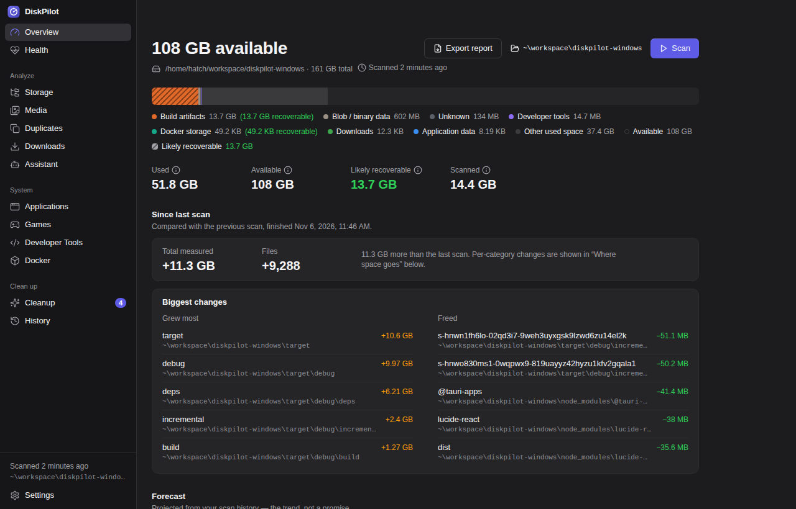
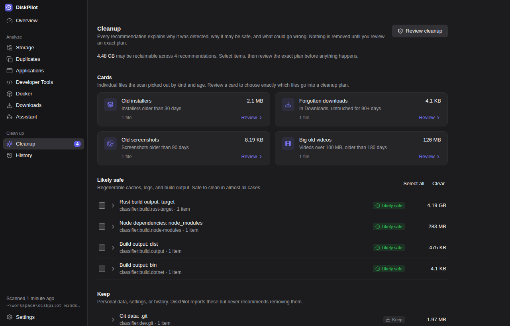
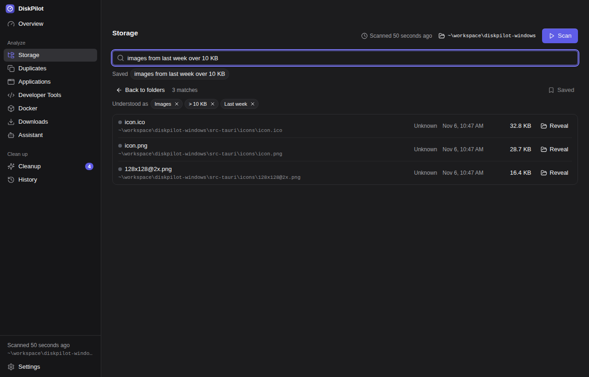
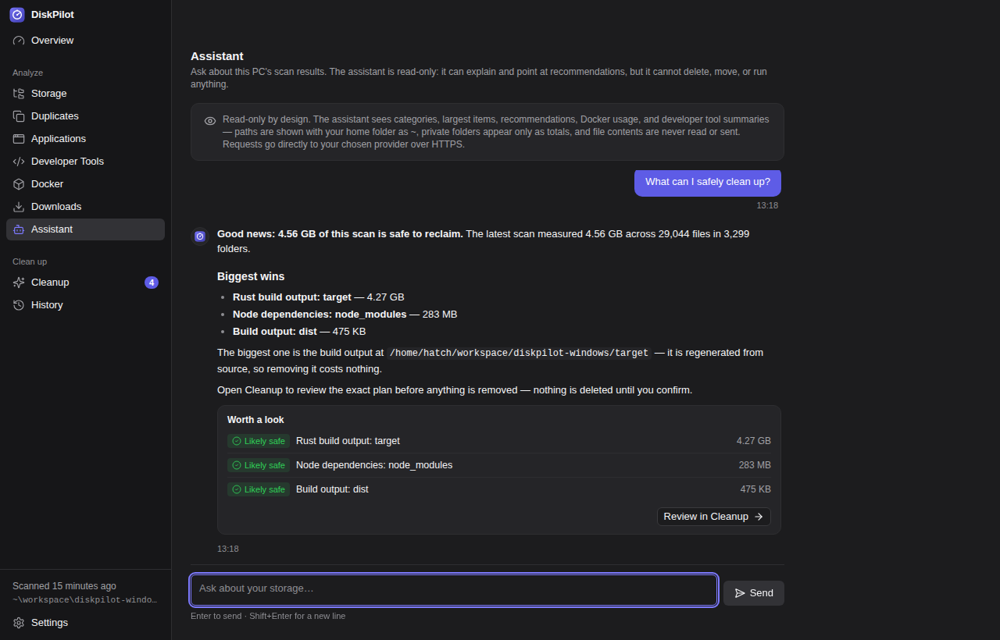
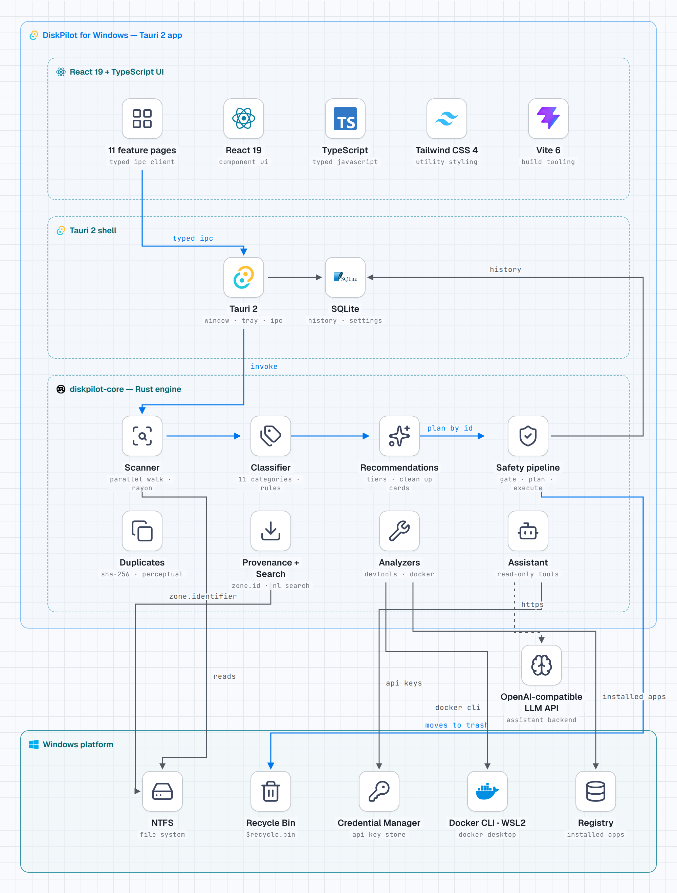

# DiskPilot for Windows

**Understand your storage. Know what is safe. Clean it confidently.**

[](https://www.microsoft.com/windows)
[](https://tauri.app)
[](https://www.rust-lang.org)
[](https://react.dev)
[](LICENSE)

DiskPilot is open-source storage intelligence for Windows. It scans your
drives read-only, explains — in plain language — what is using space and
why it is there, and only ever removes files through a reviewed cleanup
plan that passes a strict safety gate. Nothing is deleted silently, and
the default for everything is the Recycle Bin.

## Walkthrough

[](assets/DiskPilot-Walkthrough.mp4)

**▶ Watch the full walkthrough** — a tour of the scan, the safety
pipeline, and a complete cleanup, end to end.

## What it does

### Overview & Since last scan

The first screen answers the question directly: one strip shows the
whole disk — a segment per category with the recoverable portion
hatched — plus Used / Available / Likely recoverable / Scanned figures,
the recommendations most worth reviewing, and where space goes by
category. The previous scan is kept as a snapshot, so every new scan is
also a comparison: a **Since last scan** view shows what grew, what
shrank, and what you got back — down to the folders responsible, in
**Biggest changes** lists of what grew most and what freed space.

On a multi-drive PC, every volume gets its own card on the Overview —
total and free space per drive, with a one-click scan for any drive
that isn't the current scan root. And when you need the picture as a
document, **Export report** saves a standalone HTML storage report
through the native save dialog.

### Space forecast

Every completed scan appends to a persisted scan-history time series.
A least-squares fit over the last 30 days of that history turns the
series into a forecast on the Overview: how many bytes per day the
drive is gaining, and — while it is growing — the projected date it
fills up. A flat or shrinking disk simply says so; the trend is shown,
never dressed up as a promise.

### Watch & alerts

DiskPilot can watch the disk for you. Set scheduled scans to daily or
weekly and, while the app sits in the tray, it rescans the configured
root on that schedule. After a *scheduled* scan it can notify you when
free space drops below a threshold you set (10 GB by default) or when
usage grows by more than your limit between checks (5 GB by default).
Scans you start yourself never raise alerts. An optional **launch at
sign-in** setting starts DiskPilot in the tray automatically, so the
watch is on whenever you are signed in.

### Health

One page that answers "is this PC okay?": every drive with a plain
status — *Healthy*, *Getting low*, *Low space* — judged by the room it
has left, the fill-up forecast with the growth chart behind it
(scanned size and free space across your scan history), and the watch
as configured: schedule, alert thresholds, and how many scans of
history the trend rests on.

### Storage explorer & natural-language search

Drill into the scanned tree with breadcrumbs, sorting, and a details
panel for any folder: live metadata plus its classification card (the
category, the rule that matched, a confidence level) and *Reveal in
Explorer*. A **Largest items** tab lists the 500 largest files and the
heaviest folders — with the standing reminder that size alone is never
a reason to delete.

Search skips the tree entirely. Type what you mean — `pdfs from last
week over 5 MB` — and DiskPilot shows how it understood you as a row of
removable chips (kind, size, date, source) before running a
closed-grammar search over the scan index. Searches you run often can
be **saved** and re-run against the latest scan in one click.

A **Map** tab renders the current folder as a treemap — every folder
and large file a block sized by its bytes, colored by category — for
the "where did it all go?" answer at a glance; click a folder block to
drill in. Selecting any file opens an **inspector**: its facts, its
classification, image dimensions and camera EXIF where the file
carries them, and its download source where one is recorded.

### Quick Search

Press **Ctrl+Shift+Space** anywhere in Windows and a compact search
popup appears over whatever you are doing — the same plain-language
search and understood-as chips, run against the latest scan's index.
Arrow keys move through the results, Enter reveals the file in
Explorer, and Escape (or clicking away) puts the popup away.

### Downloads & provenance

Every browser download on Windows carries a Mark of the Web
(`Zone.Identifier`) stream recording where it came from. DiskPilot
reads it: the Downloads page groups files by source — Gmail, Google
Drive, ChatGPT, GitHub, Slack, any website — and lists your most recent
downloads with their origin attached, so you can find the invoice by
remembering the email instead of the filename. Provenance is never
guessed: no stream, no source.

### OneDrive — free up space

When a OneDrive folder is present, DiskPilot detects it and reads its
on-disk footprint from the scan — how much of what syncs is actually
stored locally. From the Overview card (or the file inspector) you can
**free up space**: the selected files and folders are marked to be
kept online-only, asking OneDrive to evict the local copies. Nothing
is deleted; the files stay in OneDrive and re-download when opened,
and the local space frees as OneDrive syncs the change.

### Duplicates — exact and look-alike

Exact copies are found in two phases — group by identical size, then
confirm with SHA-256 — and every copy is re-verified byte-for-byte
immediately before it moves. Hard links are counted once, and NTFS
clones are flagged as "removing frees little". A second tab finds
**look-alike photos** (bursts, edits, resized copies) with perceptual
hashing. Look-alikes can't be byte-verified by definition, so that tab
is review-only — one copy always stays, and deletion stays with the
byte-verified flow.

### Media

Photos and videos usually hold the space that matters, so they get
their own page: totals for photos, videos, and screenshots (a subset
of photos, labelled as such), and the 15 biggest files of each kind
with their dates. The counts use exactly the same kind rules as
search, so the two never disagree. A look-alike strip counts the
near-duplicate photos the perceptual scan found and takes you
straight to them in Duplicates.

### Clean Up — tiers, cards, plans

Classification becomes recommendations in three risk tiers: *Likely
safe*, *Review first*, *Keep*. Each one explains why it was detected,
why it may be safe, and what could go wrong; where a tool has its own
hygiene command (`pnpm store prune`, a Docker prune preview), DiskPilot
shows you that command instead of deleting behind the tool's back.

On top of the tiers sit **Clean Up cards** — Old installers, Forgotten
downloads, Old screenshots, Big old videos, and Big files, long
forgotten — file-level candidates picked by age and size evidence,
each opening a review list before anything is planned.

Selecting anything builds a **cleanup plan**: exact paths, exact bytes,
warnings, and any items the safety gate rejected. Plans are single-use
and expire after 10 minutes. The default action is *Move to Recycle
Bin*; *Permanently delete* is offered only when every item in the plan
is regenerable, and card plans are Recycle-Bin-only by construction.

### Games

Games are read from the launchers' own records — Steam's
`libraryfolders.vdf` and app manifests, Epic's `.item` manifests —
and listed per library with the size each game takes: the size the
launcher recorded, or a direct measurement where it recorded none.
The page is report-only: uninstalling stays with Steam or Epic, and
DiskPilot never removes game files.

### Developer Tools

Per-tool analyzers read other applications' data **read-only** —
editors (Cursor, VS Code), AI agents (Claude Code, Codex, Gemini CLI,
Copilot), Node.js, Rust, Python, .NET, Visual Studio / JetBrains, and
local model stores (Ollama, LM Studio) — and report each item with a
state: current, stale, orphaned, superseded, or informational. A
transcript secrets check scans AI-assistant transcripts locally for
known credential formats and shows findings masked; nothing is
uploaded, and nothing is changed.

### Docker

DiskPilot locates the `docker` CLI (GUI apps don't inherit a shell
PATH), parses `docker system df -v`, and shows images, containers,
volumes, and build cache with reclaimable amounts. Actions are a closed
set — remove a stopped container, remove an unused image, prune unused
build cache — each previewed with the exact command and re-validated
before it runs. Volumes are never removed. A WSL2 diagnostic compares
the Docker virtual disk's file size with Docker's own reclaimable
figure and shows the manual compaction steps; it never runs them for
you.

### Assistant (optional, off by default)

An in-app chat over your scan data, with Anthropic, OpenAI, or
OpenRouter — bring your own key, stored in Windows Credential Manager
and never readable back through the UI. The assistant has a fixed,
read-only tool set (category totals, top items, recommendations,
Docker, developer-tool summaries). It cannot delete, move, or run
anything; its only effect is highlighting recommendations for your
review. Requests go directly to the provider's host over HTTPS with
redirects disabled, and file contents are never read or sent.

### History

Every cleanup action and every scan is appended to a local SQLite log:
timestamp, operation, paths, bytes reclaimed, errors. If DiskPilot did
it, it is in History — the audit trail for "what did this ever do?".

### Recycle Bin — restore, then empty

The Recycle Bin dialog lists the bin's current contents before
anything happens. Each item can be **restored** to its original
location — refused when something already sits there — and emptying
the bin is a two-step confirm over exactly the listed items, with live
progress and a Stop button.

### Settings & exclusions

The scan root defaults to your profile folder and can be pointed
anywhere. **Exclusions** — folder names or wildcard patterns, one per
line — keep paths out of scans entirely. Settings, the last scan
snapshot, and the history database all live in
`%APPDATA%\dev.diskpilot.windows`.

## Screenshots

| | |
|---|---|
|  |  |
| **Overview** — the disk at a glance, with the Since-last-scan comparison | **Clean Up** — cards and risk-tiered recommendations |
|  |  |
| **Search** — plain-English queries, shown as understood chips | **Assistant** — read-only chat over your scan data |

## System design



[Dark variant](assets/system-design-dark.png) ·
[Interactive HTML](assets/system-design.html)

Three layers, one direction:

```text
 Scanner ──▶ Classifier ──▶ Recommendations ──▶ Planner ──▶ Safety gate ──▶ Executor ──▶ History
 (read)      (pure)         (explain only)      (preview)   (validate)      (act)        (record)
```

- **The frontend renders and asks.** The React UI has no filesystem or
  shell access at all — its Tauri capability set grants only window
  dragging, the folder-picker dialog, and opening external links. Its
  only channel to the machine is the shell's typed command set.
- **The shell bridges.** `src-tauri` owns the window, the system tray,
  settings persistence, and one typed command per frontend call.
- **The core decides.** `diskpilot-core` is the Rust engine — and the
  only code that can remove files. The scanner walks in parallel
  (rayon), never following symlinks, junctions, or reparse points and
  never crossing volumes; the classifier is a pure rule table that
  sorts every path into one of eleven categories and explains itself;
  policies turn classifications into recommendations.
- **The planner takes IDs, never paths.** The UI sends recommendation
  IDs; the planner resolves them against the engine's own
  recommendation set, so a buggy or compromised UI cannot inject a
  path. The safety gate then validates every resolved path — absolute,
  inside your home folder and the scanned root, outside the protected
  list, no link or reparse point in the path or any parent — once when
  the plan is built and **again immediately before execution**, so a
  path swapped for a link after planning is caught.
- **Trash first.** The executor's default is the Recycle Bin via the
  operating system. Permanent deletion exists only for plans where
  every item is regenerable.
- **One measuring rule.** Every size in the product is *allocated*
  bytes — what a file occupies on disk and what a cleanup actually
  frees — measured through a single helper (`GetCompressedFileSizeW`
  on Windows), so the same file shows the same size on every page.

See [docs/ARCHITECTURE.md](docs/ARCHITECTURE.md) for the full data
flow, [docs/DESIGN.md](docs/DESIGN.md) for the design system, and
[docs/WINDOWS.md](docs/WINDOWS.md) for platform measurement details.

## Safety model

- **Protected locations are never removed:** `C:\Windows` (including
  WinSxS), `C:\Program Files`, `C:\Program Files (x86)`,
  `C:\ProgramData`, `C:\Recovery`, `C:\System Volume Information`,
  drive roots, `hiberfil.sys` / `pagefile.sys` / `swapfile.sys`, and
  the top-level folders of your profile themselves. Some locations —
  `Windows.old`, the Recycle Bin's contents — are report-only or have
  their own reviewed flow.
- **Plans are single-use and expire in 10 minutes**, with the exact
  paths and bytes shown before confirmation. Card plans can only move
  files to the Recycle Bin — permanent deletion is not minted for them
  at any layer.
- **OneDrive placeholders are never opened** during a scan (opening one
  would trigger a download); they are counted at their local size.
- **The assistant is read-only** and off by default; API keys live in
  Windows Credential Manager, never in settings files, logs, or the
  frontend.
- **Privacy:** no account, no telemetry, no analytics, no crash
  reporting. Everything is computed and stored on your machine; the
  optional Assistant is the only network feature.

## Build & run

Prerequisites:

- [Rust](https://rustup.rs) 1.82 or newer
- [Node.js](https://nodejs.org) 22 and [pnpm](https://pnpm.io) 10
- Visual Studio Build Tools with the *Desktop development with C++*
  workload (Tauri's Windows toolchain)
- WebView2 runtime (preinstalled on Windows 11 and current Windows 10;
  the installer fetches the bootstrapper if it is missing)

```powershell
pnpm install
pnpm tauri dev      # run the desktop app with hot reload
pnpm tauri build    # MSI + NSIS installers in src-tauri/target/release/bundle
```

Frontend-only development, checks, and tests:

```powershell
pnpm dev            # frontend in a browser (shows the desktop-only state)
pnpm lint           # eslint
pnpm typecheck      # tsc --noEmit
pnpm test           # vitest
cargo fmt --all -- --check
cargo clippy --workspace --all-targets -- -D warnings
cargo test --workspace
```

CI runs the full check suite on `windows-latest` and builds the MSI
and NSIS installers there; the core crate's tests also run on
`ubuntu-latest`, so the engine's logic is checked even where Windows
APIs sit behind `cfg`.

## Project layout

```text
crates/core/     Rust engine (diskpilot-core) — the safety pipeline lives here
src-tauri/       Tauri 2 shell: typed commands, tray, settings, bundle config
src/             React 19 + TypeScript frontend
  lib/           types, api bridge, store, formatting
  components/    layout, shared widgets, UI primitives
  features/      one folder per page
docs/            ARCHITECTURE.md · DESIGN.md · WINDOWS.md
assets/          screenshots and the system-design diagram
```

Documentation: [Architecture](docs/ARCHITECTURE.md) ·
[Design system](docs/DESIGN.md) · [Windows notes](docs/WINDOWS.md) ·
[Changelog](CHANGELOG.md) · [Security](SECURITY.md)

## Contributing

Contributions are welcome — see [CONTRIBUTING.md](CONTRIBUTING.md).
The bar is the safety model: new analyzers and rules must be read-only
by construction, explain themselves, and ship with tests on real
temporary folder trees.

## License

MIT — see [LICENSE](LICENSE).
